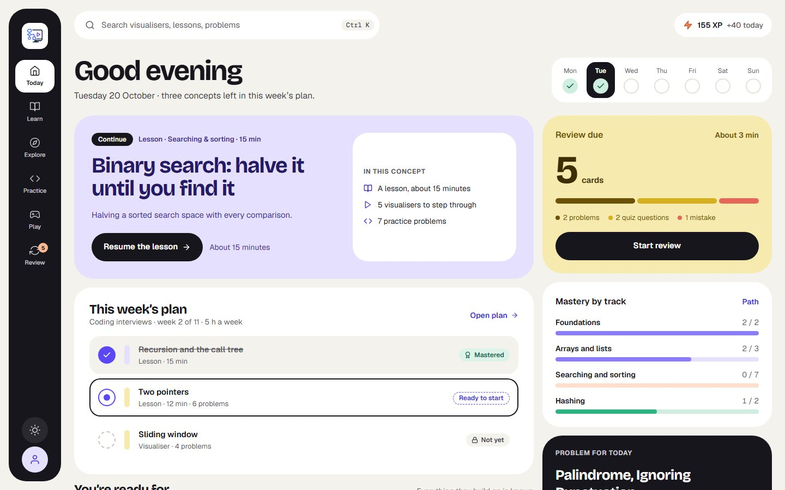
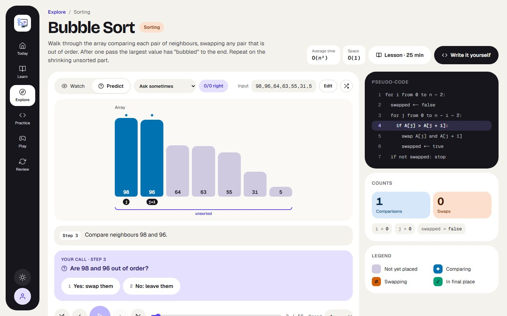
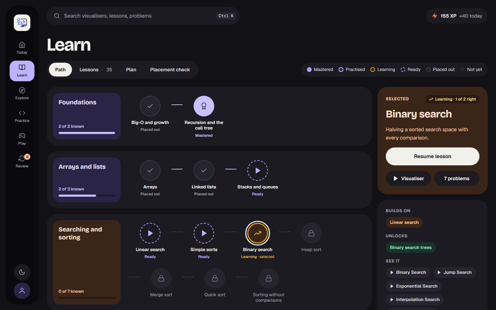
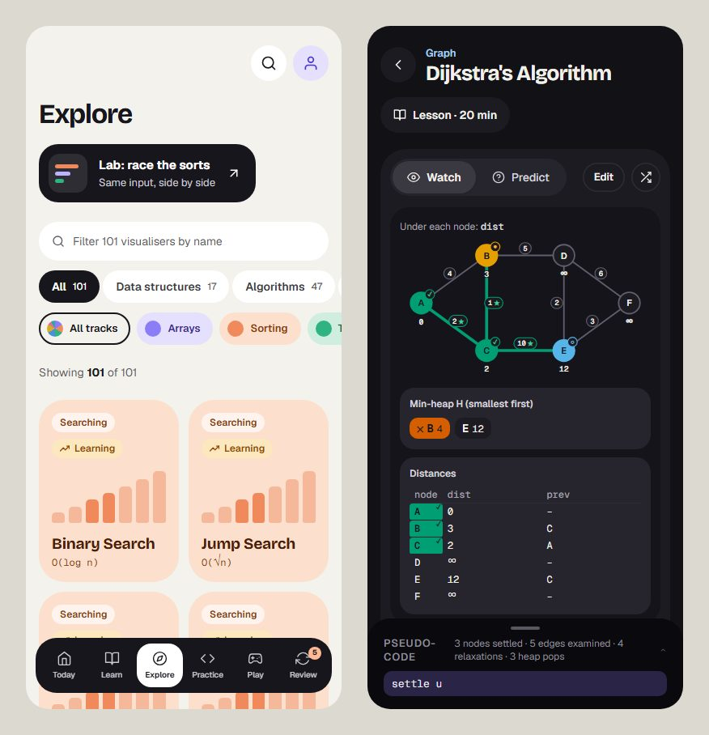

# Algorender

Algorender is a place to learn algorithms, data structures, the maths behind machine learning, and systems by watching them think. Every visualiser is a real run of the algorithm, recorded step by step and narrated, and you can stop at any decision and predict what happens next. Lessons, practice problems, a code workspace, games and a spaced review queue sit around the visualisers, and your progress is kept on your device (and synced if you sign in).

## Screenshots

| Today | A visualiser in Predict mode |
| --- | --- |
|  |  |

| Learn, in dark mode | On a phone |
| --- | --- |
|  |  |

## Features

- **Visualisers**: sorting, searching, graphs, trees, hashing, dynamic programming, backtracking and strings; linear algebra, calculus, probability, information theory, machine learning, deep learning, LLMs, reinforcement learning and diffusion; CPU scheduling, caches, consistent hashing, queueing, Raft, LSM trees and more. Step forward and back, scrub, change the input, or switch to Predict mode and answer at each decision.
- **Explore**: every visualiser as a tile, filtered by kind, track and name, with your status on each.
- **Learn**: a concept map with mastery per concept, lessons that follow a learning loop (watch, predict, do, check, explain), a placement check and a study plan.
- **Practice**: interview-style problems judged in the browser in Python, JavaScript and TypeScript (and on the server in Java, C++ and Go), code exercises from Parsons puzzles to bug hunts, pattern drills and system-design case studies on a simulator.
- **Review**: a daily spaced-review queue of the questions, problems and mistakes you've met.
- **Play**: games that test the ideas (be the algorithm, beat the comparison budget, break it), with XP for evidence of learning, levels and badges.
- **Light and dark themes**, a command palette (Ctrl K / ⌘K), and layouts for desktop and phone.

## Technologies Used

- **Framework**: Next.js 16 (App Router), React 19, TypeScript
- **Styling**: Tailwind CSS 4 with semantic theme tokens, Motion for animation
- **Accounts and progress**: Better Auth, Drizzle over Postgres (PGlite locally), an IndexedDB event log on the device
- **Tests**: Vitest with fast-check, Playwright with axe accessibility scans

## Getting Started

### Prerequisites
- Node.js 20.9 or later
- npm

### Installation

The Next.js app lives in the `algorender/` folder of the repository; run all npm commands from there.

1. Clone the repository:
   ```bash
   git clone https://github.com/coderback/Algorender.git
   cd Algorender/algorender
   ```

2. Install dependencies:
   ```bash
   npm install
   ```

3. Run the development server:
   ```bash
   npm run dev
   ```

4. Open [http://localhost:3000](http://localhost:3000) with your browser to see the application. Nothing else is needed locally: the database is an embedded Postgres in `.data/`.

## Usage

1. **Start**: a first visit shows the landing page; "Start learning" asks for a goal and a few hours a week and builds a plan. After that, `/` is Today: where to continue, what's due and this week's plan.
2. **Find something**: browse Explore or Learn, or press Ctrl K (⌘K) to search everything.
3. **Watch or predict**: play a visualiser, step through it, or switch to Predict mode and answer before each decision.
4. **Practise and review**: solve problems and exercises, then come back to the review queue each day.

## Project Structure

```
algorender/                       Next.js app
├── src/app/                      Routes, grouped by frame: (home), (shell), (detail), (focused)
├── src/engine/                   The trace engine: record a run as frames, replay it
├── src/algorithms/, structures/  Visualiser modules, one per algorithm or data structure
├── src/viz/                      The views that draw a frame (array, graph, tree, grid, plot, …)
├── src/components/               Pages' UI; src/components/ui/ holds the design-system primitives
├── src/content/                  Concept graph, lessons (MDX), problems, exercises, case studies
├── src/progress/                 The progress event log and its projections (review, mastery, plan)
└── e2e/                          Playwright tests
CLAUDE.md                         Architecture notes and conventions
REVAMP_PLAN.md                    The roadmap
```

## Adding a Visualization

1. Write a module in `algorender/src/algorithms/<family>/` (a generator that yields narrated frames) or `algorender/src/structures/<family>/` (operations on an immutable model).
2. Add it to its family's `index.ts` and to `algorender/src/data/visualisers.js`; the page at `/visualisers/<slug>`, Explore and the palette pick it up from there.
3. Add property tests next to it.

`CLAUDE.md` describes the engine, the views and the conventions in full.

## Building for Production

To create an optimized production build (from `algorender/`):

```bash
npm run build
```

Then, you can start the production server:

```bash
npm run start
```

## Deployment

Algorender deploys to [Vercel](https://vercel.com/new). Set `DATABASE_URL` (any Postgres; run `npm run db:migrate` against it first) and `BETTER_AUTH_SECRET`; `CLAUDE.md` lists the optional settings (social sign-in, the server judge, the AI tutor).

## Contributing

Contributions are welcome! If you'd like to contribute to Algorender:

1. Fork the repository
2. Create a feature branch (`git checkout -b feature/new-feature`)
3. Run `npm run lint`, `npm run typecheck`, `npm test` and `npm run build` in `algorender/` to check your changes
4. Commit your changes (`git commit -m 'feat(feature): new feature'`)
5. Push to the branch (`git push origin feature/new-feature`)
6. Open a Pull Request
